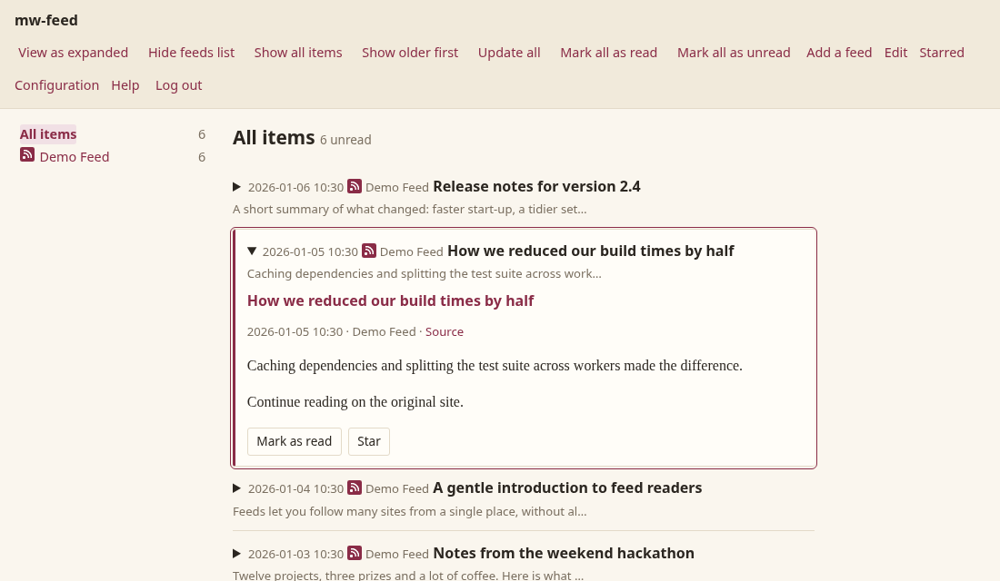

<!-- SPDX-License-Identifier: GPL-3.0-or-later -->
<!-- Structure adaptée de Best-README-Template : https://github.com/othneildrew/Best-README-Template -->
<a id="readme-top"></a>

[![Licence : GPL v3+][license-shield]][license-url]
[![Go][go-shield]][go-url]

<br />
<div align="center">
  <h1>mw-feed</h1>

  <p>
    Un lecteur de flux auto-hébergé pour un seul utilisateur. Un binaire, un fichier SQLite, aucun JavaScript requis.
    <br />
    <a href="README.md">English</a>
    ·
    <a href="docs/PLAN.md"><strong>Notes de conception</strong></a> (en français)
  </p>
</div>

<details>
  <summary>Table des matières</summary>
  <ol>
    <li>
      <a href="#à-propos-du-projet">À propos du projet</a>
      <ul>
        <li><a href="#réalisé-avec">Réalisé avec</a></li>
      </ul>
    </li>
    <li>
      <a href="#pour-commencer">Pour commencer</a>
      <ul>
        <li><a href="#prérequis">Prérequis</a></li>
        <li><a href="#installation">Installation</a></li>
      </ul>
    </li>
    <li>
      <a href="#utilisation">Utilisation</a>
      <ul>
        <li><a href="#première-utilisation">Première utilisation</a></li>
        <li><a href="#configuration">Configuration</a></li>
        <li><a href="#données-et-sauvegarde">Données et sauvegarde</a></li>
        <li><a href="#reverse-proxy">Reverse proxy</a></li>
      </ul>
    </li>
    <li><a href="#contribuer">Contribuer</a></li>
    <li><a href="#licence">Licence</a></li>
    <li><a href="#remerciements">Remerciements</a></li>
  </ol>
</details>

## À propos du projet

<a href="docs/images/screenshot-light.png">
  <picture>
    <source media="(prefers-color-scheme: dark)" srcset="docs/images/screenshot-dark.png">
    
  </picture>
</a>

mw-feed suit vos flux RSS, Atom et JSON depuis une seule page, sur un serveur qui vous appartient.

* **Flux et dossiers** : ajout d'un flux par son URL, classement en dossiers (un flux peut être dans plusieurs), import et export OPML.
* **Lecture** : liste repliable ou vue étendue, éléments non lus ou tous, du plus récent au plus ancien ou l'inverse, pagination, éléments étoilés conservés même si le flux les efface.
* **Mises à jour** : en arrière-plan, par flux, par dossier ou pour tout, à la demande.
* **Fonctionne sans JavaScript** : chaque page et chaque action est un simple formulaire. Avec JavaScript, les actions ne rechargent plus la page, et des raccourcis clavier et la navigation au balayage s'ajoutent (touche `?` ou page Aide).
* **Discret par défaut** : un seul utilisateur, mots de passe Argon2id, bannissement temporaire après des échecs de connexion répétés, protection CSRF sur chaque formulaire, politique de sécurité de contenu stricte, HTML des articles assaini, et aucune requête vers un tiers tant que vous n'activez pas les favicons.
* **Thèmes clair et sombre**, anglais, français et allemand.

<p align="right">(<a href="#readme-top">retour en haut</a>)</p>

### Réalisé avec

* [Go](https://go.dev/) : un binaire statique unique, gabarits et ressources embarqués.
* [SQLite](https://www.sqlite.org/) via [modernc.org/sqlite](https://gitlab.com/cznic/sqlite) : sans CGO.
* [gofeed](https://github.com/mmcdole/gofeed) pour lire les flux et [bluemonday](https://github.com/microcosm-cc/bluemonday) pour assainir les articles.
* [golang.org/x/crypto](https://pkg.go.dev/golang.org/x/crypto) pour Argon2id.
* [Playwright](https://playwright.dev/) pour les tests de navigateur (développement uniquement ; rien n'en est livré).

<p align="right">(<a href="#readme-top">retour en haut</a>)</p>

## Pour commencer

### Prérequis

L'un des deux :

* Docker (avec Docker Compose pour l'exemple compose), ou
* Go 1.27 ou plus récent, pour compiler le binaire vous-même.

### Installation

mw-feed n'est publié ni sous forme d'image prête à l'emploi ni en version : vous le construisez à partir des sources.

**Avec Docker**

1. Construisez l'image depuis la racine du dépôt.
   ```sh
   docker build -t mw-feed .
   ```
2. Lancez-la avec un volume pour les données.
   ```sh
   docker run -d --name mw-feed -p 8080:8080 -v mw-feed-data:/data mw-feed
   ```
3. Ouvrez <http://localhost:8080>.

La même chose avec Docker Compose :

```yaml
services:
  mw-feed:
    build: .
    ports:
      - "8080:8080"
    volumes:
      - mw-feed-data:/data
    restart: unless-stopped

volumes:
  mw-feed-data:
```

L'image s'exécute sans droits root, n'a pas de shell et déclare une vérification de santé (`mw-feed healthcheck`, qui interroge `/healthz`). `docker ps` affiche le conteneur comme `healthy` une fois le serveur prêt.

**Avec le binaire**

1. Compilez-le.
   ```sh
   cd src
   CGO_ENABLED=0 go build -o mw-feed ./cmd/mw-feed
   ```
2. Démarrez-le. Le dossier de données est créé si besoin.
   ```sh
   ./mw-feed serve --data ./data
   ```
3. Ouvrez <http://localhost:8080>.

`./mw-feed version` affiche la version.

<p align="right">(<a href="#readme-top">retour en haut</a>)</p>

## Utilisation

### Première utilisation

1. La première visite affiche le formulaire d'installation : choisissez un identifiant et un mot de passe. Il ne peut plus être utilisé une fois le compte créé.
2. Utilisez **Ajouter un flux** (une URL, éventuellement des dossiers), ou ouvrez **Éditer** puis **Importer** pour reprendre un fichier OPML d'un autre lecteur.
3. Lisez, étoilez, marquez comme lu. **Aide** liste les raccourcis clavier, et **Configuration** les réglages de lecture (vue, filtre, ordre, éléments par page, thème, langue, etc.).

### Configuration

Le serveur lui-même se configure par des options ou des variables d'environnement. Une option l'emporte sur la variable, qui l'emporte sur la valeur par défaut.

| Option | Variable d'environnement | Défaut | Rôle |
|--------|--------------------------|--------|------|
| `--addr` | `MW_FEED_ADDR` | `:8080` | Adresse d'écoute. |
| `--data` | `MW_FEED_DATA` | `./data` (`/data` dans l'image) | Dossier contenant la base de données. |
| `--trust-proxy` | `MW_FEED_TRUST_PROXY` | désactivé | Fait confiance à `X-Forwarded-For` et `X-Forwarded-Proto`. À activer **uniquement** derrière un reverse proxy qui renseigne lui-même ces deux en-têtes et ignore ceux envoyés par les clients. |
| `--allow-private` | `MW_FEED_ALLOW_PRIVATE` | désactivé | Autorise les flux situés sur des adresses privées ou locales. Elles sont refusées par défaut, pour qu'une URL de flux ne serve pas à atteindre votre réseau interne. |

Les variables booléennes acceptent `1`, `true`, `0`, `false` et les écritures usuelles.

Tout le reste (titre, langue, thème, vue, filtre, ordre, éléments par page, anonymisation des liens, favicons, etc.) se règle dans la page **Configuration**. Les favicons sont désactivés par défaut : les activer télécharge l'icône de chaque site chez DuckDuckGo, qui apprend alors quels sites vous suivez.

### Données et sauvegarde

Tout tient dans une base SQLite, `mw-feed.db`, dans le dossier de données. SQLite fonctionne en mode WAL : `mw-feed.db-wal` et `mw-feed.db-shm` peuvent se trouver à côté pendant que le serveur tourne. Pour obtenir une copie cohérente, **arrêtez le serveur, copiez tout le dossier de données, puis redémarrez-le**.

Avec un volume Docker :

```sh
docker stop mw-feed
docker run --rm -v mw-feed-data:/data -v "$PWD":/backup alpine \
  tar czf /backup/mw-feed-backup.tar.gz -C /data .
docker start mw-feed
```

Pour restaurer dans un volume vide (l'utilisateur de l'image a l'identifiant `65532`) :

```sh
docker run --rm -v mw-feed-data:/data -v "$PWD":/backup alpine \
  sh -c "tar xzf /backup/mw-feed-backup.tar.gz -C /data && chown -R 65532:65532 /data"
```

Vos abonnements peuvent aussi être exportés à tout moment en fichier OPML depuis la page **Éditer**.

### Reverse proxy

mw-feed parle en HTTP simple. Pour le servir en HTTPS, placez un reverse proxy devant et démarrez mw-feed avec `MW_FEED_TRUST_PROXY=true`. Le proxy **doit** renseigner lui-même `X-Forwarded-For` et `X-Forwarded-Proto` et écarter tout en-tête de ce nom envoyé par le client : mw-feed utilise le premier pour distinguer les visiteurs lors du bannissement de connexion, et le second pour savoir que la connexion est sécurisée (les cookies reçoivent l'attribut `Secure` et l'en-tête HSTS est envoyé).

Caddy renseigne lui-même les deux en-têtes et ignore ceux que les clients envoient :

```caddyfile
feed.example.org {
    reverse_proxy 127.0.0.1:8080
}
```

nginx :

```nginx
server {
    listen 443 ssl;
    server_name feed.example.org;
    # ssl_certificate et ssl_certificate_key vont ici

    location / {
        proxy_pass http://127.0.0.1:8080;
        proxy_set_header Host $host;
        proxy_set_header X-Forwarded-For $remote_addr;   # remplacer, ne pas ajouter
        proxy_set_header X-Forwarded-Proto $scheme;
    }
}
```

Quand le proxy tourne sur la même machine, ne publiez le port que sur l'adresse locale (`-p 127.0.0.1:8080:8080`). mw-feed doit être servi à la racine d'un nom d'hôte : un sous-chemin n'est pas pris en charge.

<p align="right">(<a href="#readme-top">retour en haut</a>)</p>

## Contribuer

Les sources sont dans `src/` ; les tests de navigateur sont dans `e2e/`.

```sh
cd src
gofmt -l .                 # ne doit rien afficher
go vet ./...
golangci-lint run ./...
go test -race ./...
CGO_ENABLED=0 go build ./...
```

Tests de navigateur (Node.js et le téléchargement de Chromium sont nécessaires ; ce sont des outils de développement uniquement) :

```sh
cd e2e
npm ci
npx playwright install chromium
npm run test:unit         # logique du script, sans navigateur
npm test                   # compile le binaire et le pilote dans Chromium
```

Hooks Git (une fois par clone) : `scripts/install-hooks.sh` active un hook `pre-commit` (gitleaks sur ce que vous indexez, gofmt, `go vet` ; il exige [gitleaks](https://github.com/gitleaks/gitleaks#installing) et refuse le commit sans lui) et un hook `pre-push` qui lance toute la CI sur votre machine (`scripts/ci-local.sh` : vérifications Go, tests de navigateur, image Docker ; il faut Go, golangci-lint, Node et Docker). Pour écarter volontairement les étapes lentes : `CI_LOCAL_SKIP=e2e,docker git push`. `scripts/test-hooks.sh` teste les hooks eux-mêmes.

Les décisions de conception, avec leurs raisons, sont dans [docs/PLAN.md](docs/PLAN.md). Les traductions sont dans `src/internal/i18n/locales/` ; les textes français et allemands ajoutés pour ce projet sont listés pour relecture dans [docs/i18n-review.md](docs/i18n-review.md).

<p align="right">(<a href="#readme-top">retour en haut</a>)</p>

## Licence

GNU General Public License v3.0 ou ultérieure. Voir [LICENSE](LICENSE) et [NOTICE](NOTICE) (composants tiers et leurs licences).

<p align="right">(<a href="#readme-top">retour en haut</a>)</p>

## Remerciements

* **KrISS feed**, un lecteur de flux PHP créé par **Tontof** ([tontof.net](http://tontof.net), [github.com/tontof/kriss_feed](https://github.com/tontof/kriss_feed)). mw-feed est une réécriture indépendante de son comportement ; aucun code ni ressource du projet d'origine n'est repris.
* Les auteurs des bibliothèques listées dans [NOTICE](NOTICE).
* [Best-README-Template](https://github.com/othneildrew/Best-README-Template), dont ce fichier suit la structure.

<p align="right">(<a href="#readme-top">retour en haut</a>)</p>

<!-- LIENS ET IMAGES MARKDOWN -->
[license-shield]: https://img.shields.io/badge/licence-GPL--3.0--or--later-blue.svg
[license-url]: LICENSE
[go-shield]: https://img.shields.io/badge/Go-1.27-00ADD8?logo=go&logoColor=white
[go-url]: https://go.dev/
