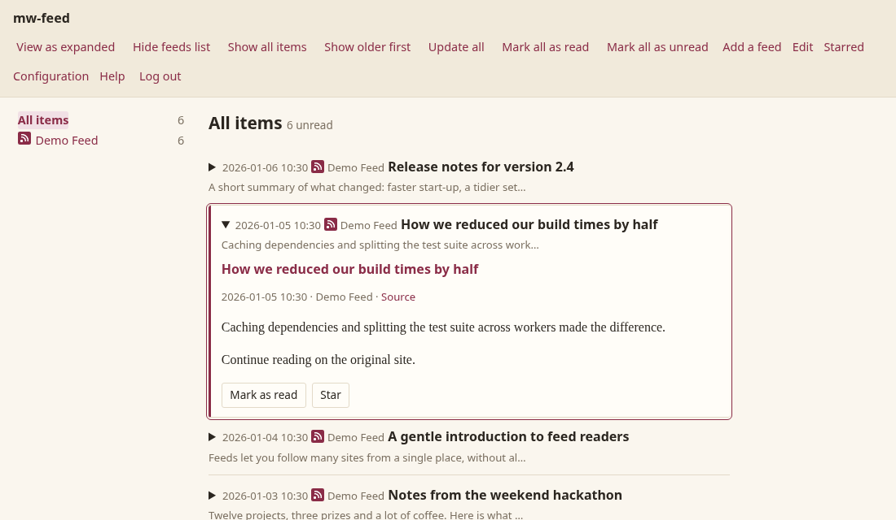

<!-- SPDX-License-Identifier: GPL-3.0-or-later -->
<!-- Structure adapted from Best-README-Template: https://github.com/othneildrew/Best-README-Template -->
<a id="readme-top"></a>

[![License: GPL v3+][license-shield]][license-url]
[![Go][go-shield]][go-url]

<br />
<div align="center">
  <h1>mw-feed</h1>

  <p>
    A self-hosted, single-user feed reader. One binary, one SQLite file, no JavaScript required.
    <br />
    <a href="README.fr.md">Français</a>
    ·
    <a href="docs/PLAN.md"><strong>Design notes</strong></a> (in French)
  </p>
</div>

<details>
  <summary>Table of contents</summary>
  <ol>
    <li>
      <a href="#about-the-project">About the project</a>
      <ul>
        <li><a href="#built-with">Built with</a></li>
      </ul>
    </li>
    <li>
      <a href="#getting-started">Getting started</a>
      <ul>
        <li><a href="#prerequisites">Prerequisites</a></li>
        <li><a href="#installation">Installation</a></li>
      </ul>
    </li>
    <li>
      <a href="#usage">Usage</a>
      <ul>
        <li><a href="#first-use">First use</a></li>
        <li><a href="#configuration">Configuration</a></li>
        <li><a href="#data-and-backup">Data and backup</a></li>
        <li><a href="#reverse-proxy">Reverse proxy</a></li>
      </ul>
    </li>
    <li><a href="#contributing">Contributing</a></li>
    <li><a href="#license">License</a></li>
    <li><a href="#acknowledgments">Acknowledgments</a></li>
  </ol>
</details>

## About the project

<a href="docs/images/screenshot-light.png">
  <picture>
    <source media="(prefers-color-scheme: dark)" srcset="docs/images/screenshot-dark.png">
    
  </picture>
</a>

mw-feed follows your RSS, Atom and JSON feeds from a single page, on a server you own.

* **Feeds and folders**: add a feed by URL, organise feeds in folders (a feed can be in several), import and export OPML.
* **Reading**: a collapsible list or a fully expanded view, unread or all items, newest or oldest first, pagination, starred items that outlive their feed.
* **Updates**: in the background, per feed, per folder or for everything on demand.
* **Works without JavaScript**: every page and action is a plain form. With JavaScript, actions no longer reload the page and keyboard shortcuts and swipe navigation are added (press `?` or open the Help page).
* **Private by default**: single user, Argon2id passwords, temporary ban after repeated failed logins, CSRF protection on every form, a strict Content Security Policy, sanitised article HTML, and no request to a third party unless you turn favicons on.
* **Light and dark themes**, English, French and German.

<p align="right">(<a href="#readme-top">back to top</a>)</p>

### Built with

* [Go](https://go.dev/): a single static binary, templates and assets embedded.
* [SQLite](https://www.sqlite.org/) through [modernc.org/sqlite](https://gitlab.com/cznic/sqlite): no CGO.
* [gofeed](https://github.com/mmcdole/gofeed) to read feeds and [bluemonday](https://github.com/microcosm-cc/bluemonday) to sanitise articles.
* [golang.org/x/crypto](https://pkg.go.dev/golang.org/x/crypto) for Argon2id.
* [Playwright](https://playwright.dev/) for the browser tests (development only; nothing of it is shipped).

<p align="right">(<a href="#readme-top">back to top</a>)</p>

## Getting started

### Prerequisites

Either of:

* Docker (with Docker Compose for the compose example), or
* Go 1.27 or later, to build the binary yourself.

### Installation

mw-feed is not published as a ready-made image or release: you build it from the source.

**With Docker**

1. Build the image from the root of the repository.
   ```sh
   docker build -t mw-feed .
   ```
2. Run it with a volume for the data.
   ```sh
   docker run -d --name mw-feed -p 8080:8080 -v mw-feed-data:/data mw-feed
   ```
3. Open <http://localhost:8080>.

The same with Docker Compose:

```yaml
services:
  mw-feed:
    build: .
    ports:
      - "8080:8080"
    volumes:
      - mw-feed-data:/data
    restart: unless-stopped

volumes:
  mw-feed-data:
```

The image runs as a non-root user, has no shell, and declares a health check (`mw-feed healthcheck`, which queries `/healthz`). `docker ps` shows the container as `healthy` once the server is up.

**With the binary**

1. Build it.
   ```sh
   cd src
   CGO_ENABLED=0 go build -o mw-feed ./cmd/mw-feed
   ```
2. Start it. The data directory is created if needed.
   ```sh
   ./mw-feed serve --data ./data
   ```
3. Open <http://localhost:8080>.

`./mw-feed version` prints the version.

<p align="right">(<a href="#readme-top">back to top</a>)</p>

## Usage

### First use

1. The first visit shows the installation form: choose a login and a password. It cannot be used again once the account exists.
2. Use **Add a feed** (a URL, optionally folders), or open **Edit** and use **Import** to bring in an OPML file from another reader.
3. Read, star, mark as read. **Help** lists the keyboard shortcuts, and **Configuration** the reading settings (view, filter, order, items per page, theme, language and more).

### Configuration

The server itself is configured with flags or environment variables. A flag wins over the environment, which wins over the default.

| Flag | Environment variable | Default | Meaning |
|------|----------------------|---------|---------|
| `--addr` | `MW_FEED_ADDR` | `:8080` | Listen address. |
| `--data` | `MW_FEED_DATA` | `./data` (`/data` in the image) | Directory holding the database. |
| `--trust-proxy` | `MW_FEED_TRUST_PROXY` | off | Trust `X-Forwarded-For` and `X-Forwarded-Proto`. Turn it on **only** behind a reverse proxy that sets both itself and ignores what clients send. |
| `--allow-private` | `MW_FEED_ALLOW_PRIVATE` | off | Allow feeds on private and loopback addresses. By default these are refused, so that a feed URL cannot be used to reach your internal network. |

Boolean variables accept `1`, `true`, `0`, `false` and the usual spellings.

Everything else (title, language, theme, view, filter, order, items per page, link anonymisation, favicons, and so on) is set in the **Configuration** page. Favicons are off by default: turning them on downloads each site's icon from DuckDuckGo, which then learns which sites you follow.

### Data and backup

Everything lives in one SQLite database, `mw-feed.db`, in the data directory. SQLite runs in WAL mode, so `mw-feed.db-wal` and `mw-feed.db-shm` may sit beside it while the server runs. To get a consistent copy, **stop the server, copy the whole data directory, start it again**.

With a Docker volume:

```sh
docker stop mw-feed
docker run --rm -v mw-feed-data:/data -v "$PWD":/backup alpine \
  tar czf /backup/mw-feed-backup.tar.gz -C /data .
docker start mw-feed
```

To restore into an empty volume (the image's user has the id `65532`):

```sh
docker run --rm -v mw-feed-data:/data -v "$PWD":/backup alpine \
  sh -c "tar xzf /backup/mw-feed-backup.tar.gz -C /data && chown -R 65532:65532 /data"
```

Your subscriptions can also be exported at any time as an OPML file from the **Edit** page.

### Reverse proxy

mw-feed speaks plain HTTP. To serve it over HTTPS, put a reverse proxy in front and start mw-feed with `MW_FEED_TRUST_PROXY=true`. The proxy **must** set `X-Forwarded-For` and `X-Forwarded-Proto` itself and discard any such header sent by the client: mw-feed uses the first one to tell visitors apart for the login ban, and the second to know the connection is secure (cookies get the `Secure` flag, and the HSTS header is sent).

Caddy sets both headers itself and ignores the ones clients send:

```caddyfile
feed.example.org {
    reverse_proxy 127.0.0.1:8080
}
```

nginx:

```nginx
server {
    listen 443 ssl;
    server_name feed.example.org;
    # ssl_certificate and ssl_certificate_key go here

    location / {
        proxy_pass http://127.0.0.1:8080;
        proxy_set_header Host $host;
        proxy_set_header X-Forwarded-For $remote_addr;   # replace, do not append
        proxy_set_header X-Forwarded-Proto $scheme;
    }
}
```

When a proxy runs on the same host, publish the port on the loopback address only (`-p 127.0.0.1:8080:8080`). mw-feed must be served at the root of a host name: a sub-path is not supported.

<p align="right">(<a href="#readme-top">back to top</a>)</p>

## Contributing

The source is in `src/`; the browser tests are in `e2e/`.

```sh
cd src
gofmt -l .                 # must print nothing
go vet ./...
golangci-lint run ./...
go test -race ./...
CGO_ENABLED=0 go build ./...
```

Browser tests (Node.js and a Chromium download are needed; they are development tools only):

```sh
cd e2e
npm ci
npx playwright install chromium
npm run test:unit         # logic of the script, no browser
npm test                   # builds the binary and drives it in Chromium
```

Git hooks (run once per clone): `scripts/install-hooks.sh` turns on a `pre-commit` hook (gitleaks on what you stage, gofmt, `go vet`; it needs [gitleaks](https://github.com/gitleaks/gitleaks#installing) and refuses the commit without it) and a `pre-push` hook that runs the whole CI on your machine (`scripts/ci-local.sh`: Go checks, browser tests, Docker image; it needs Go, golangci-lint, Node and Docker). To leave slow steps out on purpose: `CI_LOCAL_SKIP=e2e,docker git push`. `scripts/test-hooks.sh` tests the hooks themselves.

Test coverage: `scripts/coverage.sh` runs the tests and prints a table per package and the total (`--html FILE` writes the line-by-line report). A line counts as covered when any test of the module runs it. The same table appears in the summary of each CI run, with the HTML report as an artifact. `cmd/mw-feed` looks low because its tests run the compiled binary as a separate process, which Go cannot measure.

The design decisions, with their reasons, are in [docs/PLAN.md](docs/PLAN.md). Translations are in `src/internal/i18n/locales/`; German and French strings added for this project are listed for review in [docs/i18n-review.md](docs/i18n-review.md).

<p align="right">(<a href="#readme-top">back to top</a>)</p>

## License

GNU General Public License v3.0 or later. See [LICENSE](LICENSE) and [NOTICE](NOTICE) (third-party components and their licences).

<p align="right">(<a href="#readme-top">back to top</a>)</p>

## Acknowledgments

* **KrISS feed**, a PHP feed reader created by **Tontof** ([tontof.net](http://tontof.net), [github.com/tontof/kriss_feed](https://github.com/tontof/kriss_feed)). mw-feed is an independent rewrite of its behaviour; no code or asset from the original project is reused.
* The authors of the libraries listed in [NOTICE](NOTICE).
* [Best-README-Template](https://github.com/othneildrew/Best-README-Template), whose structure this file follows.

<p align="right">(<a href="#readme-top">back to top</a>)</p>

<!-- MARKDOWN LINKS & IMAGES -->
[license-shield]: https://img.shields.io/badge/license-GPL--3.0--or--later-blue.svg
[license-url]: LICENSE
[go-shield]: https://img.shields.io/badge/Go-1.27-00ADD8?logo=go&logoColor=white
[go-url]: https://go.dev/
